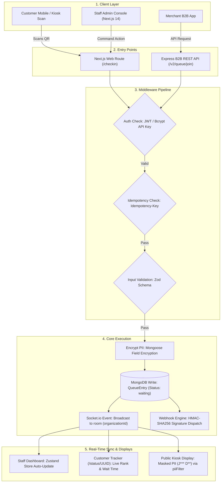

# Flow-Q: Next-Gen Real-Time Queue & Appointment Management Platform

> **Built by:** Nadam Eshwanth Raj & Ambilpur Vaishnav

---

## 1. Problem & Solution

### Problem
* **Congested Waiting Rooms:** High physical density creates discomfort and health risks.
* **Zero Queue Visibility:** Customers lack real-time insights into waiting position and estimated arrival time.
* **Manual Operational Overhead:** Staff manually manage paper logs, causing human error, missed slots, and low throughput.

### Solution
* **Zero-Install Mobile Check-in:** Customers scan QR codes and join queues instantly via web browsers without app downloads.
* **Live Position Tracking:** Mobile status view (`/status/[uuid]`) displays live rank and dynamic estimated wait time.
* **Real-time Command Console:** Staff call, serve, pause, and cancel queue entries in one click from an interactive dashboard.
* **Multi-Tenant B2B QaaS:** Headless REST API with API key security and HMAC webhooks to power external business workflows.

---

## 2. Flow of Execution of the Project



---

## 3. Important Architectural Tradeoffs

* **In-Memory PII Decryption vs. Native Database Indexing:**
  * *Tradeoff:* Encrypting PII at rest prevents MongoDB native regex and text searches.
  * *Decision:* Query candidate records by unencrypted metadata (`organizationId`, `status`), then decrypt and filter in memory. Accepts higher CPU/RAM usage to prevent plain-text PII storage in database.

* **WebSocket Rooms vs. Client HTTP Polling:**
  * *Tradeoff:* Maintaining persistent WebSocket connections consumes server RAM and TCP sockets.
  * *Decision:* Eliminates HTTP polling overhead and guarantees sub-100ms state updates across all connected devices.

* **Nested Document Schemas vs. Relational Normalization:**
  * *Tradeoff:* Embedding locations and service settings inside `Organization` document risks document size limits.
  * *Decision:* Eliminates `$lookup` joins, optimizing single-document fetch speed for high-concurrency check-in routes.

* **Synchronous Webhook Delivery vs. Asynchronous Message Queue:**
  * *Tradeoff:* Firing webhooks inline during API requests blocks response threads if third-party servers lag.
  * *Decision:* Simplifies initial architecture by removing message broker overhead, with immediate timeout safeguards in place.

* **Stateless Session Tokens (JWT) vs. Stateful DB Sessions:**
  * *Tradeoff:* Access tokens cannot be revoked instantly before expiry without maintaining a token blacklist.
  * *Decision:* Eliminates database reads on every authenticated HTTP request, reducing database read bottleneck.

---

## 4. How to Scale It

* **Stateless WebSockets with Redis Adapter:**
  * Deploy Node.js server instances behind an Application Load Balancer (ALB).
  * Integrate `@socket.io/redis-adapter` with Redis Pub/Sub to broadcast WebSocket events across all server nodes seamlessly.

* **Database Sharding & Read-Write Separation (MongoDB):**
  * Route read traffic (public monitors, customer status pages) to Secondary Replicas using `secondaryPreferred`.
  * Shard MongoDB cluster using `organizationId` as the shard key to isolate tenant data and localize query operations.

* **Asynchronous Task Queue (BullMQ + Redis):**
  * Offload SMS alerts (Fast2SMS) and B2B webhook retries from Express HTTP threads to BullMQ background workers.
  * Return immediate `201 Created` responses while workers process retries asynchronously with exponential backoff.

* **In-Memory Caching (Redis):**
  * Cache verified API keys (1-hour TTL) in Redis for sub-millisecond auth checks.
  * Cache idempotency locks and response payloads in Redis to prevent DB lock contention during high-concurrency double-clicks.

* **Blind Indexing for Encrypted Search:**
  * Replace in-memory decryption filtering with HMAC-salted blind indexes for fast, indexed queries on encrypted customer data.

---

## 5. Key Engineering Decisions (Resume Deep Dive)

* **Multi-Tenant QaaS Platform with Zero-Install QR Check-ins & Live Position Tracking:**
  * *What:* A customer scans a QR code. The QR code opens a web page in the customer's mobile browser. The customer does not install an app. The system adds the customer to the queue. The system gives the customer a unique link (`/status/[uuid]`). That link shows the customer's live position number. It also shows the estimated wait time. The system updates both values in real time using WebSockets.
  * *Why:* An app install stops many customers from joining. A web-only flow removes that barrier. Live position data lets customers wait away from the physical location. This reduces crowding at the venue.

* **Secure B2B REST API (JWT Auth, Idempotency Checks, Zod Validation, HMAC-SHA256 Webhooks):**
  * *What:* An external merchant sends requests to a versioned REST API (`/v2/`). The system checks a JWT access token or a bcrypt-hashed API key on each request. Each write request must include an `Idempotency-Key` header. The system checks that key against MongoDB. If the key already exists, the system does not create a duplicate entry. The system also checks each request body against a Zod schema. When the queue state changes, the system builds a payload. The system signs the payload with HMAC-SHA256. The system then sends that payload to the merchant's webhook URL.
  * *Why:* JWT removes the need for a database read on every request. The idempotency check stops duplicate entries caused by network retries. Zod rejects bad data before it reaches the database. The HMAC signature lets the merchant verify that the event came from Flow-Q and was not changed in transit.

* **Persistent WebSockets for Sub-100ms UI Updates & In-Memory PII Decryption Before Public Display Masking:**
  * *What:* Socket.io keeps a persistent TCP connection open for each client. The system groups clients by `organizationId` into named rooms. When a queue entry changes state (join, call, serve, or cancel), the system emits an event to that room. All connected dashboards and status pages update immediately. The system stores customer PII (name, phone number) as AES-encrypted data in MongoDB. When the system serves the public kiosk display, it decrypts the records in memory. It then runs the data through a `piiFilter`. The filter masks the output (for example, `J*** D**`) before the system sends it to the client.
  * *Why:* Persistent sockets remove the need for HTTP polling. This keeps state updates under 100ms. In-memory decryption means plain-text PII is never stored or sent to the public display. Customer data stays protected while the kiosk still shows a usable queue view.

* **Staff Admin Console with Zustand State Management & Nested MongoDB Document Schemas:**
  * *What:* The staff dashboard runs in Next.js. It uses Zustand as the client-side state store. When a Socket.io event arrives, it updates the Zustand store directly. React re-renders the affected components. No prop drilling is needed. No extra API calls are made. On the database side, the system stores location details and service settings as nested subdocuments inside the parent `Organization` document. The system does not store them in separate collections.
  * *Why:* Zustand connects to socket event handlers with minimal code. It keeps the UI reactive without the setup cost of Redux. Nested subdocuments remove the need for `$lookup` joins on every read. This lowers query time on the high-traffic check-in and dashboard routes.

---

## 6. Developer Quick Start

* **Prerequisites:** Node.js (v18+), MongoDB.

* **Backend Setup:**
  ```bash
  cd backend
  npm install
  npm run dev
  ```

* **Frontend Setup:**
  ```bash
  cd frontend-next
  npm install
  npm run dev
  ```

* **Run Tests:**
  ```bash
  cd backend
  npm run test:unit
  node tests/test-all-endpoints.js
  ```
